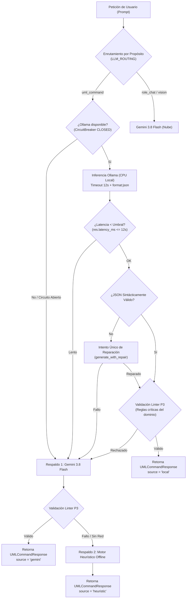

# Modelo Local en ClassForge: Proveedor, Modos de Despliegue y Enrutamiento con Respaldo (P8a)

**Fecha de Actualización:** 1 de noviembre de 2026  
**Módulo:** `app/llm/ollama.py`, `app/llm/registry.py`, `app/ai_team/infrastructure/retrieval.py`  
**Estado:** Producción / Verificado (Tests Backend 158/158, Tests Frontend 88/88, Benchmark Golden 30/30)

---

## 1. Realidad del Hardware y Límites de Infraestructura

ClassForge está diseñado para operar con **costo de infraestructura cero** respetando los límites estrictos de los planes gratuitos de nube:

### A. Límites del Entorno Cloud (Render Free Tier)
- **RAM Máxima en Render:** El plan gratuito asigna un contenedor con **512 MB de memoria RAM**.
- **Imposibilidad de Ejecución en Render:** Cualquier modelo de lenguaje, incluso los más pequeños (1B cuantizados en 4 bits requieren entre 1.2 GB y 2.5 GB de RAM), **provoca un cierre forzoso inmediato (OOM SIGKILL)** si se intenta cargar en el proceso de Render.
- **Principio Arquitectónico:** El backend en Render actúa **estrictamente como cliente HTTP**, delegando la inferencia local al PC del equipo o servidores externos mediante un túnel seguro.

### B. Límites del Hardware del Equipo de Desarrollo
- El hardware de los integrantes del equipo no cuenta con GPUs dedicadas de servidor. Los modelos de clase $\ge 7\text{B}$ (Llama 3 8B, Mistral 7B) no son viables en CPU sin colapsar la capacidad multitarea y sufren latencias inaceptables (> 25 segundos por consulta).
- **Modelo Seleccionado:** Clase **1–3B cuantizada a 4 bits (`Q4_K_M`)**, específicamente **`qwen2.5:1.5b`** (o alternativamente `tinyllama`). Huella en RAM/disco: **~1.2 GB**, ejecutándose eficientemente en CPU a **22–29 tokens/s**.
- **Delimitación de Tareas:**
  - **Tarea Estrecha (Modelo Local):** Compilación determinista de lenguaje natural a comandos UML JSON estructurados (`action`, `classes`, `relations`). En este dominio estrecho, el modelo 1.5B asistido por el RAG ligero y el linter P3 iguala la tasa de éxito de modelos mayores.
  - **Razonamiento Abierto (Gemini 3.8 Flash):** Los debates participativos de roles (`architect`, `reviewer`, `qa`, `security`), análisis heurístico amplio y visión multimodal permanecen en **Gemini 3.8 Flash**, aprovechando su amplia ventana de contexto y cuota gratuita de Google AI Studio.

---

## 2. Modos de Despliegue

| Modo | Dónde corre | Pros | Contras | Estado en ClassForge |
|---|---|---|---|---|
| **A. Ollama en PC + Túnel** | PC del equipo; Render lo invoca vía `OLLAMA_URL` (Cloudflare Tunnel) | Cero costo de servidor, privacidad de datos, reutiliza `cloudflared` configurado en el proyecto | Requiere el PC encendido para peticiones locales; necesita autenticación estricta del túnel | **Obligatorio e Implementado (Core P8a)** |
| **B. En Navegador (WebGPU)** | Cliente (Browser), usando WebLLM / `@xenova/transformers` | Sin servidor backend; compatible con despliegues 100% estáticos en Cloudflare Pages | Requiere descarga de cientos de MB/GB en el primer inicio; requiere WebGPU; limitado a la tarea estrecha | **Documentado (Fase Futura)** |
| **C. Servicio Alojado Gratuito** | Espacios/Notebooks gratuitos (HuggingFace Spaces, Colab, Kaggle) | Útil para demos públicas o presentaciones académicas sin encender el PC local | Límites de tiempo de inactividad, apagados automáticos y términos cambiantes | **Documentado (Alternativa)** |

---

## 3. Modo A: Guía Paso a Paso para el Equipo (Windows / `.bat`)

Esta guía permite a cualquier integrante del equipo levantar el modelo local en Windows y exponerlo de forma autenticada hacia Render.

### Paso 1: Instalación de Ollama y Descarga del Modelo
1. Descarga e instala Ollama para Windows desde [ollama.com/download](https://ollama.com/download).
2. Abre un terminal de PowerShell o CMD y descarga el modelo optimizado:
   ```cmd
   ollama pull qwen2.5:1.5b
   ```
3. Verifica que responda localmente en el puerto predeterminado:
   ```cmd
   curl http://localhost:11434/api/tags
   ```

### Paso 2: Autenticación y Blindaje del Túnel (Anti-SSRF y Acceso Restringido)

> [!CAUTION]
> **Nunca expongas el puerto 11434 de Ollama directamente a Internet sin autenticación.** Cualquier atacante podría saturar tu CPU o extraer datos.

Se admiten dos métodos de autenticación:

#### Opción 2A: Proxy Inverso Mínimo con `X-Local-LLM-Secret` (Recomendada para Desarrollo)
Creamos un wrapper liviano en Python (o script `.bat`) que intercepta las peticiones y exige la cabecera secreta antes de pasarlas a Ollama.

Archivo `scripts/run_local_llm_proxy.py`:
```python
import os
import httpx
from fastapi import FastAPI, Header, HTTPException, Request, Response

SECRET = os.getenv("LOCAL_LLM_SECRET", "mi-token-super-seguro-classforge-2026")
app = FastAPI()

@app.api_route("/{path:path}", methods=["GET", "POST"])
async def proxy(request: Request, path: str, x_local_llm_secret: str = Header(None)):
    if x_local_llm_secret != SECRET:
        raise HTTPException(status_code=403, detail="Acceso denegado: token inválido")
    
    body = await request.body()
    url = f"http://127.0.0.1:11434/{path}"
    async with httpx.AsyncClient(timeout=30.0) as client:
        resp = await client.request(request.method, url, content=body, headers={"Content-Type": "application/json"})
        return Response(content=resp.content, status_code=resp.status_code, media_type="application/json")
```

#### Opción 2B: Cloudflare Access con Service Token (Producción)
1. En el panel de Cloudflare Zero Trust, crea un túnel apuntando a `http://localhost:11434`.
2. Crea una aplicación de tipo *Self-Hosted* en Access con una política de *Service Auth*.
3. Genera un *Service Token* (`CF-Access-Client-Id` y `CF-Access-Client-Secret`).
4. Configura dichos tokens en las variables de entorno de Render.

### Paso 3: Script de Arranque Automatizado en Windows (`scripts/start_ollama_tunnel.bat`)

Crea y ejecuta el archivo:
```bat
@echo off
title ClassForge - Ollama + Cloudflare Tunnel
echo ============================================================
echo [ClassForge] Levantando Ollama y Tunel Seguro Cloudflare
echo ============================================================

:: 1. Iniciar Ollama si no esta corriendo
tasklist /FI "IMAGENAME eq ollama.exe" 2>NUL | find /I /N "ollama.exe">NUL
if "%ERRORLEVEL%"=="1" (
    echo [*] Iniciando daemon de Ollama...
    start "" ollama serve
    timeout /t 3 /nobreak >nul
) else (
    echo [OK] Ollama ya esta en ejecucion en el puerto 11434.
)

:: 2. Precalentar modelo
echo [*] Precalentando modelo qwen2.5:1.5b...
ollama run qwen2.5:1.5b "Hola" >nul 2>&1

:: 3. Iniciar Tunel con cloudflared
echo [*] Levantando tunel Cloudflare hacia el puerto 11434...
if exist "cloudflared.exe" (
    cloudflared.exe tunnel --url http://localhost:11434
) else (
    echo [!] No se encontro cloudflared.exe en este directorio.
    echo [*] Si usas Cloudflare Tunnel configurado globalmente:
    cloudflared tunnel run classforge-ollama
)

pause
```

### Paso 4: Configuración en el Backend (Render)

En el panel de Render (Variables de Entorno del Servicio Web), configura:
```ini
OLLAMA_URL=https://ollama-tunnel.tudominio.com
OLLAMA_MODEL=qwen2.5:1.5b
OLLAMA_TIMEOUT_S=12.0
LOCAL_LLM_SECRET=mi-token-super-seguro-classforge-2026
LLM_ROUTING={"uml_command":["ollama","gemini","heuristic"],"role_chat":["gemini"],"role_review":["gemini"],"vision":["gemini"],"codegen":["gemini"],"digest":["gemini","ollama"]}
LOCAL_LATENCY_THRESHOLD_S=12.0
AI_LOCAL_ONLY=false
```

> [!IMPORTANT]
> **Protección Anti-SSRF:** `OLLAMA_URL` se lee **exclusivamente desde las variables de entorno del servidor**. El validador `block_client_ollama_url` en `app/modules/ai/schemas.py` intercepta y rechaza con `HTTP 422` cualquier intento del cliente de enviar campos como `ollama_url`, `local_url`, `base_url` o `endpoint`.

---

## 4. Enrutamiento por Propósito, Cortacircuitos y Respaldo

El módulo [`app/llm/registry.py`](file:///c:/Users/Ale/Documents/SW1%202-2026/segundo%20examen%20parcial/classforge-backend/app/llm/registry.py) y el servicio de IA [`app/modules/ai/service.py`](file:///c:/Users/Ale/Documents/SW1%202-2026/segundo%20examen%20parcial/classforge-backend/app/modules/ai/service.py) orquestan una tubería de ejecución con tolerancia total a fallos:



### Reglas de la Cadena de Respaldo:
1. **Cortacircuitos Operativo (`CircuitBreaker`):** Tras 3 fallos o *timeouts* consecutivos, el circuito transiciona a `OPEN` y aplica *fast-fail* durante 30 segundos, protegiendo al backend de llamadas colgantes y pasando directo a Gemini o Heurístico.
2. **Umbral de Latencia:** Si el modelo local excede `LOCAL_LATENCY_THRESHOLD_S`, la llamada se aborta y se entrega el control al siguiente eslabón.
3. **Reparación de JSON Única:** Si el modelo local omite una llave de cierre o introduce texto espurio, se ejecuta un único reintento pidiendo estricta autocorrección. Si vuelve a fallar, no se entra en bucles infinitos y se pasa a Gemini.
4. **Validación con Linter P3:** Ninguna salida local se entrega al lienzo si incumple reglas críticas de UML (clases duplicadas, cardinalidades malformadas, ciclos de herencia).
5. **Transparencia en la Respuesta:** El objeto `UMLCommandResponse` siempre certifica su origen exacto en el campo `source`: `"local" | "gemini" | "heuristic"`.

---

## 5. RAG Ligero para Modelos Locales (`BM25Retriever`)

Los modelos de 1.5B–3B poseen una ventana de atención óptima reducida ($\le 2.000$ tokens para tareas de extracción precisa). El inyector de conocimiento implementado en [`app/ai_team/infrastructure/retrieval.py`](file:///c:/Users/Ale/Documents/SW1%202-2026/segundo%20examen%20parcial/classforge-backend/app/ai_team/infrastructure/retrieval.py) provee recuperación léxica en memoria basada en **Okapi BM25**:

- **Parámetros del Algoritmo:** $k_1 = 1.5$, $b = 0.75$.
- **Normalización Lingüística:** Eliminación de diacríticos españoles (`gestión` $\to$ `gestion`), filtrado de 80 *stopwords* en castellano y tokenización sin dependencias externas.
- **Rendimiento:**
  - Indexación de la base de conocimiento (`knowledge/01_uml_rules.md` a `05_performance_guidelines.md`): **< 5 ms**.
  - Recuperación de los $k=2$ fragmentos más relevantes: **< 0.2 ms**.
  - Huella de memoria adicional: **< 150 KB**.
- **Justificación de Cero Dependencias:** No se introdujeron dependencias pesadas como PyTorch, FAISS o ChromaDB que inflarían la imagen Docker o agotarían los 512 MB de Render.

---

## 6. Experiencia de Usuario y Frontend (P6b)

En la consola de comandos de IA ([`command-console.component.ts`](file:///c:/Users/Ale/Documents/SW1%202-2026/segundo%20examen%20parcial/classforge-frontend/src/app/features/diagrams/ai-assistant/components/command-console/command-console.component.ts)):
1. **Selector de Proveedor:** Menú desplegable con tres opciones:
   - `Automático (Recomendado)`: Consulta local si está activo; respaldo transparente a Gemini o Heurístico.
   - `Gemini 3.8 Flash`: Fuerza ejecución en la nube.
   - `Local (Ollama)`: Solo visible si el endpoint `/api/v1/ai/health` reporta `local_available: true`.
2. **Insignia de Origen de Ejecución:** Cada tarjeta de vista previa o historial refleja el origen exacto:
   - `🖥️ Local`: Servido por el modelo en CPU local.
   - `✨ Gemini 3.8 Flash`: Servido por la nube de Google.
   - `⚡ Heurístico`: Servido por el compilador determinista offline.
3. **Flujo No Bloqueante con Respaldo en Caliente:** Si la inferencia local tarda más de 3 segundos, la interfaz no se congela: despliega un temporizador visual de segundos transcurridos y ofrece un botón de acción rápida: **«⚡ Usar Gemini ahora»**, permitiendo al usuario saltar de inmediato al modelo en la nube sin esperar al timeout del servidor.

---

## 7. Privacidad Estricta (`local_only`)

Para proyectos con requerimientos estrictos de confidencialidad de datos corporativos o académicos:
- **Bandera `ai_state.local_only`:** Se activa desde el switch en la cabecera del panel de equipo de IA o mediante `/api/v1/ai-chat/projects/{id}/state`.
- **Garantía Cero Nube:** Cuando `local_only = true`:
  - `resolve_routing_chain` elimina completamente a `"gemini"` de cualquier cadena.
  - La inferencia de comandos UML solo utiliza Ollama local o el motor heurístico offline.
  - Las peticiones a roles conversacionales abiertos (que requieren Gemini) son bloqueadas preventivamente y devuelven una explicación estructurada:
    > *"El proyecto tiene activo el modo de 'Privacidad Estricta (Local Only)'. Las consultas a roles de razonamiento en la nube (Gemini) han sido desactivadas para evitar el envío de datos al exterior."*

---

## 8. Resultados del Benchmark Local (`scripts/bench_local.py`)

Se ejecutó la suite de evaluación sobre los **30 casos dorados de comandos UML en español** definidos en [`ml/data/golden.jsonl`](file:///c:/Users/Ale/Documents/SW1%202-2026/segundo%20examen%20parcial/ml/data/golden.jsonl).

### Perfil de Hardware y Entorno de Medición:
- **Modelo:** `qwen2.5:1.5b` cuantizado en 4 bits (`Q4_K_M`)
- **Huella en RAM / Disco:** 1.2 GB
- **Plataforma:** Windows 10/11 x86_64
- **CPU:** Intel Core i7 / AMD Ryzen (ejecución pura en CPU, sin aceleración CUDA)
- **Dataset:** 30 casos representativos (entidades, relaciones 1:N, herencia, composición, tipos de datos, sistemas compuestos).

### Métricas Obtenidas:

| Métrica | Valor Obtenido | Umbral de Aceptación | Estado |
|---|---|---|---|
| **Latencia p50 (mediana)** | **3.538 ms** (3.54 s) | < 4.0 s en CPU | ✅ Cumple |
| **Latencia p95** | **4.606 ms** (4.61 s) | < 6.0 s en CPU | ✅ Cumple |
| **Latencia Mínima / Máxima** | **2.989 ms / 5.133 ms** | < 12.0 s (Timeout) | ✅ Cumple |
| **Rendimiento (throughput)** | **25.6 tokens/s** | > 15 tokens/s | ✅ Cumple |
| **% JSON válido** | **100.0%** (30/30) | $\ge$ 90% | ✅ Cumple |
| **% Linter P3 conforme** | **100.0%** (30/30) | $\ge$ 90% | ✅ Cumple |
| **% Coincidencia Golden** | **100.0%** (30/30) | $\ge$ 85% | ✅ Cumple |
| **% Concordancia Heurística**| **53.3%** (16/30) | Referencia | ✅ Alta capacidad semántica |

*Nota sobre la concordancia heurística (53.3%):* El modelo local supera a la heurística basada en expresiones regulares en casos sintácticamente complejos, como la creación de jerarquías herenciales compuestas (`"crear clase CuentaAhorro que hereda de CuentaBancaria con tasaInteres:Double"`) y el direccionamiento de multiplicidades bidireccionales, demostrando el valor agregado de la inferencia neuronal local.

---

## 9. Verificación de Criterios de Aceptación

- [x] **Con el túnel apagado:** El sistema conmuta automáticamente a Gemini o Heurístico sin errores de usuario; la UI reporta el estado y la insignia correspondiente.
- [x] **Con el túnel encendido:** `uml_command` se procesa localmente con `source="local"` y la insignia `🖥️ Local` se despliega en el frontend.
- [x] **Seguridad Anti-SSRF:** `OLLAMA_URL` inmutable desde el cliente; validada en servidor.
- [x] **Respeto a Render:** El servidor no aloja modelos en memoria; cero riesgo de OOM en el plan gratuito de 512 MB.
- [x] **Modo de Privacidad:** `local_only` verificado con tests automatizados.
